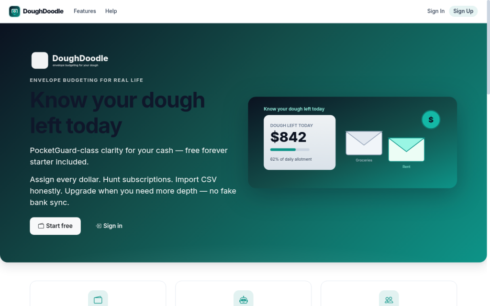
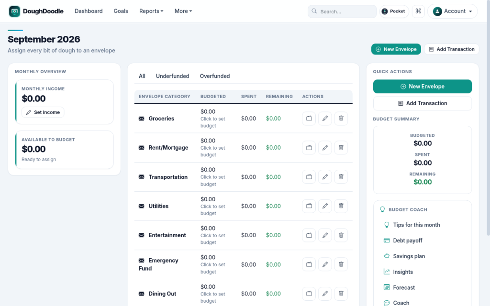
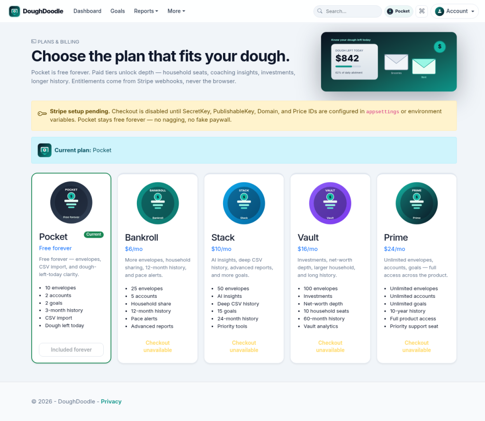

# DoughDoodle

Envelope budgeting built around your money. ASP.NET Core 8 MVC + Identity + SQLite.

Assign income to envelopes, track spending, see **dough left today**, and keep PreferredCurrency honest (including ZAR). CSV / OFX / QFX / QIF import is the real bank path. Optional AI advisory only when provider keys are set; otherwise rule-based coaching. No fake Plaid / Open Banking claims.

Status detail: [`PRODUCT_STATUS.md`](PRODUCT_STATUS.md).

**Status — 1 Oct 2026:** premium navy + mint fintech UI, plan display names **Pocket / Bankroll / Stack / Vault / Prime**. Import KPIs use real session totals (export downloads are not tracked, shown as 0). Onboarding `defaults` seeds starter envelopes; `minimal` does not. PreferredCurrency covers admin chart ticks and dough-left pace copy. PWA `doughdoodle-v15` (HTML navigations network-only). Screenshots below are the 25 Sep set.







## What works today

| Area | Notes |
|---|---|
| Envelopes | Categories, monthly budgets, transfers, rollover |
| Safe to spend | Dough-left / pace style surfaces on the dashboard |
| Money in/out | Accounts, transactions, bills, recurring, search |
| Goals & reports | Goals plus overview / trends / cash-flow reports |
| Import | CSV · OFX · QFX · QIF + mapping templates (honest — no live bank OAuth) |
| Household | Soft share / seats on paid plans (polish ongoing) |
| Membership | Freemium Stripe Checkout / Portal when `Stripe:*` keys exist; honest setup-pending UI otherwise |
| Currency | PreferredCurrency + `CurrencyDisplay` (no mystery ¤) |
| Themes | Ocean, Forest, Sunset, Purple, Dark, High Contrast |

## Plans (display names)

C# enums / Stripe PriceId keys keep legacy identifiers; **users see**:

| Display | Role |
|---|---|
| **Pocket** | Free forever — core envelopes + CSV |
| **Bankroll** | Household share, richer reports |
| **Stack** | More history / power tools |
| **Vault** | Investments unlock, larger household |
| **Prime** | Top tier |

## Honest limits

- No fake always-on LLM — AI advisors need keys; rules always available.
- Bank sync / Plaid only when provider keys exist; Link is not claimed as live without them.
- SQLite is single-node — not multi-region hosting.
- Never nag for Stripe keys in product copy.

## Stack

.NET 8 · ASP.NET Core MVC · EF Core + SQLite · Bootstrap 5 · Bootstrap Icons (vendored) · Chart.js

## Run locally

```bash
git clone https://github.com/iDeedz/DoughDoodle.git
cd DoughDoodle
dotnet restore
dotnet build
dotnet run
```

Open the URL from `Properties/launchSettings.json` (workspace often uses `http://127.0.0.1:5000`).

Demo (Development seed only): `demo@doughdoodle.com` / `Demo123!`

```bash
dotnet test
```

## Screenshots

| Screen | |
|---|---|
| Landing |  |
| Dashboard |  |
| Plans |  |

## License / Contributing

Copyright (C) 2026 iDeedz. DoughDoodle is licensed under the GNU General Public License v3.0 only (GPL-3.0-only). The full text is [`LICENSE`](LICENSE).

If you distribute this program or a modified version, you must release the corresponding source under GPL-3.0 as well.

Pull requests go to `develop`. Do not commit API keys, SMTP or database passwords, `.env` files, local `appsettings` overrides, `*.db` / `*.sqlite` files, or `App_Data` user data. Keep checked-in settings as empty placeholders and put real values in user-secrets or environment variables.
